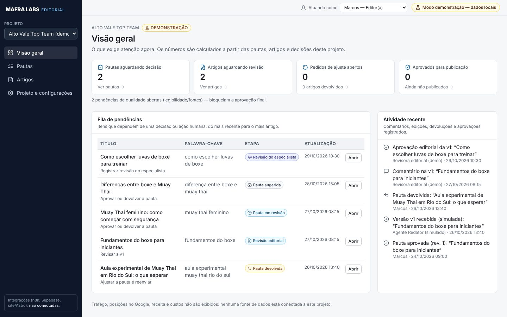
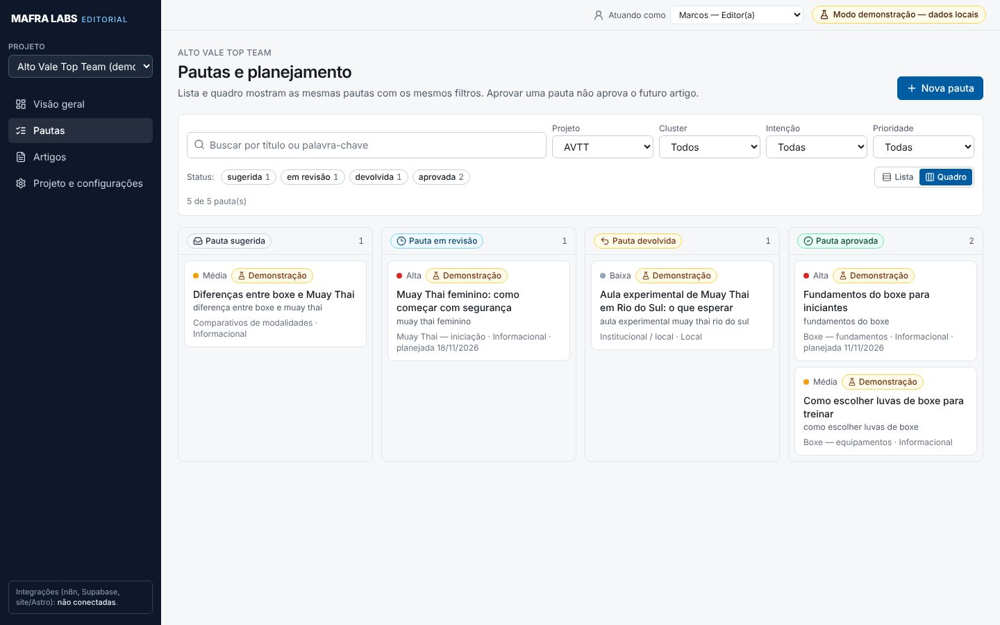
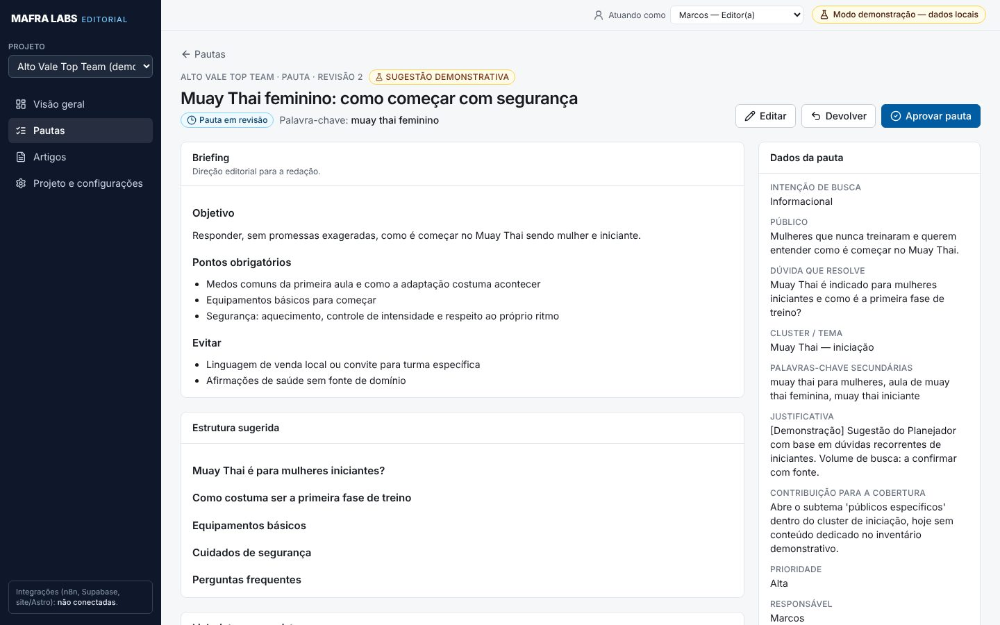
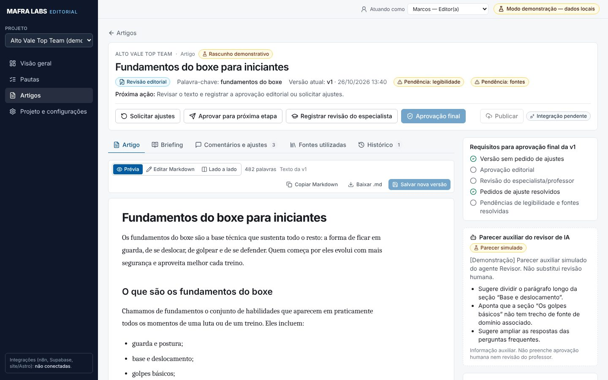
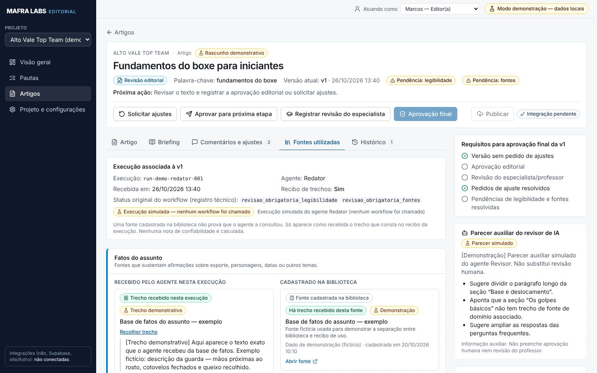
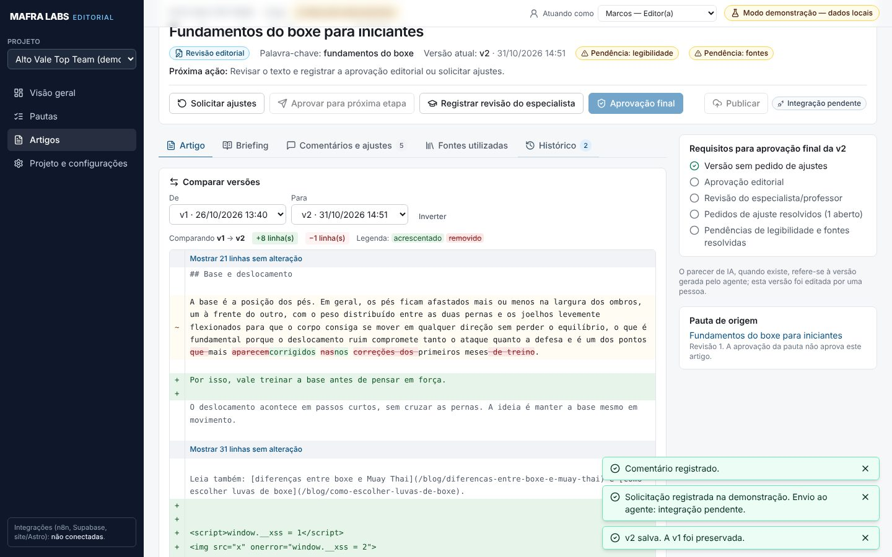
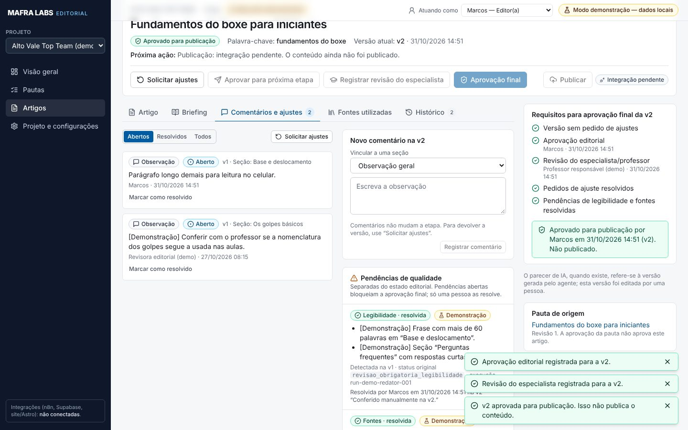
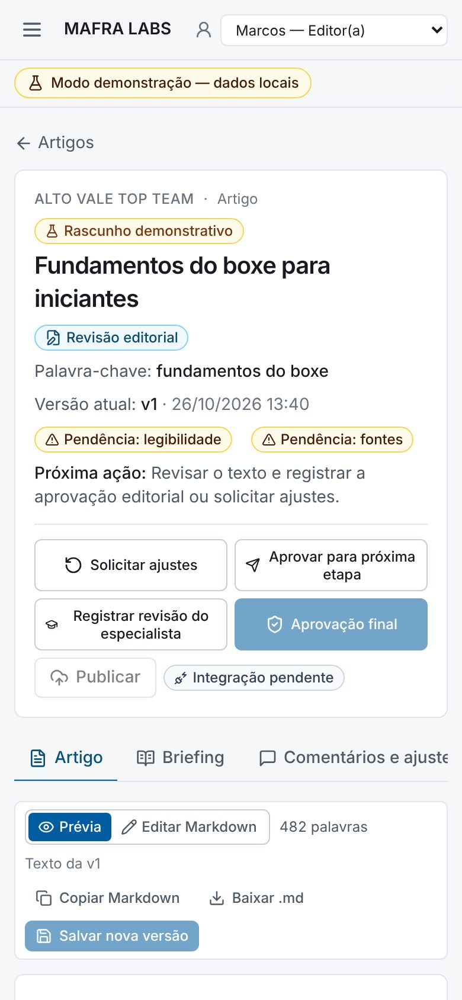

# MAFRA LABS — Editorial

Painel de gestão editorial de SEO para a agência. Conectado à **fila editorial V2 do n8n** (cliente piloto: Alto Vale Top Team): lista pautas e trabalhos reais, mostra o artigo em Markdown, estado, versão do artigo, revisão do registro e pendências do Revisor, e registra edição, devolução e aprovação editorial — sempre pelos workflows existentes, nunca gravando direto na tabela.

Aplicação isolada: não compartilha build, dependências nem rotas com o SEO Analyst da raiz deste repositório.

## Duas áreas

| Rota | O que é | Dados |
|---|---|---|
| `/entrar`, `/fila`, `/fila/<job_key>` | Painel real (autenticado) | Fila editorial V2 do n8n, via backend do painel e adaptador autenticado |
| `/p/...` | Protótipo demonstrativo da primeira entrega | Fictícios, no `localStorage`; **desligado em produção** (`PAINEL_DEMO=0`) |

Aprovação editorial ≠ revisão do professor ≠ autorização de publicação. O painel mostra os três separadamente e não publica no site.

## Rodar localmente

```bash
cd painel-editorial
npm install
cp .env.example .env.local   # preencher segredos de teste; ver DEPLOY.md
npm run dev
```

Abra http://localhost:3100. Sem um adaptador n8n acessível, o painel real mostra o erro de conexão com código (`N8N_INDISPONIVEL`) — nunca dados simulados.

Implantação, acesso por túnel SSH, atualização e reversão: [DEPLOY.md](./DEPLOY.md).

## Verificações

```bash
npm run typecheck   # TypeScript
npm run lint        # ESLint
npm test            # Vitest: sessão/senha, entradas montadas pela sessão, sanitização, adaptador n8n, regras do protótipo, Markdown seguro
```

Validação do painel real no navegador (Playwright; mutações só em registros do ambiente teste):

```bash
BASE_URL=http://127.0.0.1:3100 SENHA_MARCOS_ARQ=... SENHA_LEITOR_ARQ=... FASE=principal node scripts/validar-painel-real.cjs
```

Jornada do protótipo demonstrativo (com `PAINEL_DEMO=1`):

```bash
node scripts/jornada-e2e.cjs ./capturas
```

## Painel real (fila V2)

- **Fila** (`/fila`): trabalhos do cliente com filtro **Produção / Teste**, busca, estado, versão, pendências e situação da aprovação.
- **Trabalho** (`/fila/<job_key>?ambiente=...`): título, pauta, palavra-chave, estado, **versão do artigo** e **revisão do registro**; cartões separados para aprovação editorial, revisão do professor e publicação; abas Artigo (leitura/edição/lado a lado, copiar, baixar), Pendências do Revisor e Histórico e versões (com comparação entre versões).
- **Ações** (só `editor_responsavel`): salvar edição (cria nova versão e invalida aprovação anterior), devolver com motivos, aprovar editorialmente. Com pendências, a aprovação exige marcar cada pendência como avaliada e escrever a justificativa — nada é preenchido automaticamente.
- Cada mutação leva `revisao_esperada`, `artigo_sha256` e um `op_id` estável (reaproveitado só quando a tentativa anterior idêntica teve resultado incerto). Versão antiga é recusada (`VERSAO_DESATUALIZADA`).
- Falhas mostram o código (`N8N_INDISPONIVEL`, `FILA_OCUPADA`, `VERSAO_DESATUALIZADA`...) e o botão **Tentar novamente**.

## Protótipo demonstrativo (`/p`)

As telas da primeira entrega (pautas, quadro, revisão por versão, fontes, histórico) continuam no código como referência de evolução, com dados fictícios e sem conexão. Ficam desligadas em produção.

### Regras do protótipo

- Ciclo da pauta, ciclo do artigo e pendências de qualidade são separados.
- A etapa do artigo é **derivada das decisões registradas na versão atual**. Nova versão volta para revisão; decisões anteriores ficam só no histórico.
- Biblioteca de fontes ≠ trecho recebido pelo agente. Sem recibo: “Uso não comprovado nesta execução”.

## Estrutura

```
src/
  app/api/     rotas do servidor (auth, fila, health) — só rodam no servidor
  app/entrar   login · app/fila  painel real · app/p  protótipo demonstrativo
  server/      config, sessão/senha, cliente do adaptador, montagem de entradas, sanitização, erros
  components/real/  telas reais · components/  UI, Markdown seguro, comparação de versões
  domain/ data/ state/  protótipo demonstrativo (regras e armazenamento local)
n8n/adaptador/ código dos nós do workflow adaptador · n8n/adaptador-painel.workflow.json
deploy/        docker-compose, painelctl.sh, .env.example
tests/         testes unitários (Vitest)
```

## Dados demonstrativos

Pautas, artigos, execuções, trechos e inventário são fictícios e marcados como demonstração. Exceção: dois trechos de “Informações do cliente” foram importados literalmente de `eumarcosmafra-cmyk/avtt-atendimento-ia@c59fa22:knowledge/academy/profile.md` — continuam sendo apenas fontes cadastradas, sem prova de uso por agente.

## Capturas

Geradas pela jornada `scripts/jornada-e2e.cjs` (dados de demonstração):

| | |
|---|---|
|  |  |
|  |  |
|  |  |
|  |  |
